# WeMadeIt

**Money only moves if the group means it.**

**Live:** https://wemadeit.vercel.app · **Track:** Consumer Products & Payments ·
**Metropolis** (Monad) · **Built by:** Kiter, solo · **License:** MIT

[](#running)
[](#verification)
[](#verification)

---

## Product

### What it is

WeMadeIt turns "yeah, I'm in" into a **conditional group payment**. An organizer
names a rule — *$80 each, 6 people, by Friday* — and shares one link. Everyone's
share sits in non-custodial escrow. Hit the rule and the organizer gets paid.
Miss it and everyone refunds themselves. **No tilt, no charge.**

### Who it is for

The person who fronts money for a group and then has to chase it: the friend who
booked the Airbnb, the teammate collecting for a pitch, the organizer of a trip
that keeps almost happening. They are not crypto users, and the product assumes
that — the account layer is a passkey, not a wallet.

### The problem

Group spending fails on **commitment**, not on splitting. Saying "I'm in" costs
nothing, so it means nothing, and the cost lands entirely on whoever fronted the
money. Splitwise documents that debt *after* it happens. It never prevents it.
Crowdtilt proved people want threshold-based group funding, but custodial rails
and card fees killed it.

### Value proposition

WeMadeIt answers one question **before anyone is exposed**: *will everyone
actually pay?* The money is committed up front, so the group either reaches its
rule or nobody loses anything. The organizer never chases; the contributors never
get chased.

### Why now

Three things had to exist at once, and they now do:

- **Fast finality.** Monad's ~400ms blocks mean a commit lands in under a second,
  so the live progress bar can act as social pressure while the group chat is
  still open. On a slow chain the bar is stale by the time anyone looks.
- **Micro-escrow economics.** Conditional $10 shares are only rational when an
  action costs ~$0.0001. On L1 they never were.
- **Passkeys + a dollar stablecoin.** Mera removes seed phrases; AUSD (a
  LayerZero OFT) removes currency mismatch for groups spanning countries.

### Key product insight

**The progress bar is the reminder.** Every group-payment product tries to solve
collection with notifications, which is what people already ignore. WeMadeIt
makes the group's own visible progress do the work: the awkward fourth text never
gets sent because the group can see who hasn't committed yet.

---

## User Experience

### Primary workflow

1. **Organizer** types one sentence — *"cabin weekend, 6 of us, $80 each, by
   Friday"* — and the form drafts itself. They confirm and share one link.
2. **Contributors** open the link, join with Face ID (no seed phrase, no app to
   install), see who is already in, and commit in one tap.
3. **Either** the pot fills and the organizer is paid, **or** the deadline passes
   and each contributor claims a refund.

### Activation moment

The sixth of six commits and the screen reads **WE MADE IT 🎉** — the group has
just funded something that would otherwise have quietly died in a group chat.
That moment is designed to be screenshotted, and sharing it is the notification.

### Important interactions

| Interaction | What it does |
|---|---|
| One-sentence draft | TypeSafe/Jev parses occasion, amount, headcount, deadline into a real form |
| Face ID join | Passkey → derived EOA → commit, in one ceremony, nothing installed |
| Live progress | Polls every 5s; the roster and bar update as people commit |
| Invite-only pots | Join key travels in the link `#fragment`, never through a server |
| Key rotation | Organizer can invalidate a leaked invite key with one transaction |
| Refund claim | Pull pattern — each contributor withdraws their own share |
| Fee disclosure | The exact net the payee receives is shown *before* anyone commits |

### Differentiation

| | Splitwise | WeTravel / SquadTrip | WeMadeIt |
|---|---|---|---|
| When the problem is solved | After the fact | After the fact | **Before anyone pays** |
| Custody | N/A (tracking only) | Custodial holds | **Non-custodial escrow** |
| Time to payout | Never | Weeks | **Sub-second** |
| Account required | Email | Email + KYC | **Face ID** |
| Who carries the risk | The organizer | The operator | **Nobody — it refunds** |

---

## Innovation

### What is genuinely novel

**Commitment as a first-class primitive.** Existing group-payment products move
money between people; WeMadeIt makes the *promise itself* the onchain object. The
pot is not a ledger entry about a debt — it is an escrow whose release condition
is the group's own agreement. That inversion is what removes the chase.

The second-order effect is that failure becomes free. Because the pot is
all-or-nothing, a group that doesn't reach its rule is refunded automatically, so
trying is never risky. That is what makes the "will they actually pay?" question
answerable in advance.

### What technology enables it

- **Mera passkeys** — the PRF output derives a secp256k1 EOA on device
  (BIP-39 → `m/44'/60'/0'/0/0`). No seed phrase, no extension, no custody
  backend, no smart-contract account. The private key lives only in page memory.
- **Monad finality** — sub-second commits make the live progress bar meaningful.
- **AUSD** — a dollar-denominated pot means a cross-border group settles in the
  same unit with nobody taking FX risk.
- **Envio HyperIndex** — makes a public discovery feed possible without an
  unbounded RPC scan over six factory generations.

### Why it is not a thin wrapper

The escrow is a real state machine with real invariants, not a UI over someone
else's contract:

- Per-pot EIP-1167 clones. **No owner or admin function exists on a pot** — there
  is no code path that can move a pot's principal to us or to the organizer
  before its rule is met.
- **Pull-pattern refunds**, so one contributor's failure to claim cannot block
  another's.
- **The fee is read from the factory onchain at release time**, so a caller
  cannot waive it and a pot cannot lie about it.
- **Invite-only pots enforce a `keccak256` preimage onchain**, with rotation.
- The AI features are deliberately confined to two narrow judgments and **no AI
  output can move funds**.

---

## Hackathon Relevance

### Track

**Consumer Products & Payments.** The track asks for products where onchain rails
make financial interactions feel instant and invisible. WeMadeIt's entire
front-end has no chain vocabulary: no gas, no nonce, no "connect wallet".

### Sponsor technology and meaningful integration

| Sponsor | Integration | Where |
|---|---|---|
| **Mera** (Monad Foundation) | The account layer. PRF → BIP-39 → secp256k1 session signs every pot action | `app/lib/mera.ts`, `app/lib/pactWrite.ts` |
| **Dynamic** | Second login path; embedded wallet synced into wagmi so every action shares one code path | `app/lib/wagmi.tsx` |
| **Envio** | HyperIndex powers the public feed — one GraphQL query instead of an unbounded RPC scan | `indexer/`, `app/lib/envio.ts` |
| **Agora (AUSD)** | Dollar-denominated pots; canonical AUSD, 6-decimal math end to end | `app/lib/monad.ts`, `app/components/AccountSheet.tsx` |
| **TypeSafe (Jev)** | Two narrow judgments: sentence → pot draft, and a legitimacy badge | `app/app/api/assist/*` |

Each is load-bearing. Removing Envio removes the feed; removing Mera removes the
account layer; removing AUSD removes cross-border pots.

### Relevant judging criteria

- **Product Quality & Completeness** — deployed and usable on both networks, with
  the full state machine reachable from the UI.
- **Technical Excellence** — 18/18 tests, Sourcify-verified on both chains, and a
  self-run security review with adversarial verification ([docs/SECURITY-REVIEW.md](docs/SECURITY-REVIEW.md)).
- **Monad Integration** — the product is only viable because of sub-second
  finality and micro-cost actions; see [Why now](#why-now).
- **Track Fit** — payments that never mention a blockchain to the person using
  them.
- **Innovation & Impact** — commitment as a primitive, not another expense
  tracker.

---

## Architecture



### System overview

Four parts: a Next.js PWA, two server route handlers, the Monad contracts, and an
Envio index.

### Major components

- **App** (`app/`) — Next.js 16 App Router PWA. Pot pages, public feed, create
  flow, account sheet, three sign-in paths. Client-side chain reads via
  wagmi/viem.
- **Server** (`app/app/api/`) — two route handlers that hold the TypeSafe key
  server-side. `POST /api/assist/parse` and `POST /api/assist/score`.
- **Chain** (`contracts/`) — `PactFactory` deploys EIP-1167 `PactPot` clones.
  Pots hold native MON or an ERC-20 (AUSD), and move through
  `Open → Tilted | Refunding`.
- **Index** (`indexer/`) — Envio HyperIndex across six factory generations with
  dynamic clone registration, serving one GraphQL endpoint.

### Data flow

**Create.** Form → optional Jev parse → `PactFactory.createPot` → `PotCreated`
event → clone registered by the indexer → redirect to the pot.

**Commit.** Pot page → `commit()` or `commitWithSecret()` → funds move into the
clone → `Committed` event → indexer updates `commitCount` → the feed's progress
bar moves.

**Tilt.** Anyone calls `release()` → the factory's current `feeBps` and
`feeRecipient` are read onchain → fee and payee are paid → `Tilted`.

**Miss.** After the deadline, `expire()` → `Refunding` → each contributor calls
`refund()` and is paid from the pot.

**Read.** The feed asks Envio first (one GraphQL query), unions with direct RPC
reads for pots the near-head index has not backfilled, and labels the source with
a `via Envio` tag.

### Important technical decisions

| Decision | Why | Cost we accepted |
|---|---|---|
| EIP-1167 clones, one per pot | Creating a pot is cheap; a million-person pot costs the same as a dinner pot | Clones must be verified by `factory()` — the implementation is public, so look-alikes are possible |
| Pull-pattern refunds | One contributor's failed claim cannot block others | Contributors must claim; no automatic push |
| Permissionless `release()` | No keeper, no backend, no organizer action required to pay out | Someone must trigger it; a filled pot does not pay itself |
| Fee read from the factory at release | Callers cannot waive it; the UI can show the exact net | A fee change applies to pots that filled earlier ([known risk](#known-risks)) |
| Invite key in the URL `#fragment` | The key never passes through a server in transit | The first keyed commit publishes it onchain ([known risk](#known-risks)) |
| Index starts near head | A fresh deployment syncs in ~6 minutes instead of ~10 days | Older pots come from the feed's RPC union, not the index |
| `multicall3` declared per chain | Collapses multi-contract reads; the feed went from hundreds of RPC calls to ~13 | Requires the canonical multicall address to exist (verified on both chains) |
| Explicit `chainId` on every receipt wait | A passkey session has no connected wallet, so wagmi otherwise resolves receipts against the wrong chain | — |

### External services

| Service | Role | Failure behaviour |
|---|---|---|
| QuickNode (Monad RPC) | All chain reads and writes | App shows a retry state; rate limits back off |
| Envio Cloud | Public feed index | Feed falls back to direct RPC enumeration |
| TypeSafe (Jev) | Sentence parse + legitimacy badge | Both routes return `disabled`; the manual form is the source of truth |
| Dynamic | Email/social login | Falls back to injected wallet |
| Vercel | Hosting + two route handlers | — |
| Agora AUSD faucet | Testnet AUSD for reviewers | Testnet only |

### Frontend / backend boundaries

Everything that touches a key or a paid API is server-side or on-device:

- `TYPESAFE_API_KEY` is read only inside the two route handlers and is never
  `NEXT_PUBLIC_`.
- The passkey-derived private key exists only in page memory and is never sent
  anywhere.
- The invite key never reaches a server in transit (it is a URL fragment).
- **Chain writes happen client-side, signed by the user's own account.** There is
  no server that can move funds.

---

## Running

### Prerequisites

- Node 22+ and `pnpm`
- [Foundry](https://book.getfoundry.sh/) (`forge`) for the contracts
- An RPC endpoint for Monad mainnet and/or testnet

### Installation

```bash
git clone git@github.com:PhiBao/wemadeit.git
cd wemadeit

cd contracts && forge install && forge build
cd ../app && pnpm install
cd ../indexer && pnpm install
```

### Environment variables

Create `app/.env.local` (see `app/.env.example`). Values are never committed.

| Variable | Scope | Purpose |
|---|---|---|
| `NEXT_PUBLIC_CHAIN` | public | First-visit default chain (`mainnet` in production) |
| `NEXT_PUBLIC_DYNAMIC_ENV_ID` | public identifier | Dynamic login; abuse is controlled by dashboard allowlists, not secrecy |
| `NEXT_PUBLIC_MONAD_MAINNET_RPC` | public | Mainnet RPC |
| `NEXT_PUBLIC_MONAD_TESTNET_RPC` | public | Testnet RPC |
| `NEXT_PUBLIC_ENVIO_URL` | public | Envio GraphQL endpoint; the feed falls back to RPC when unset |
| `TYPESAFE_API_KEY` | **server secret** | Assist routes. Never prefix with `NEXT_PUBLIC_` |

Factories and AUSD addresses are canonical constants in `app/lib/monad.ts` — no
env needed.

### Development

```bash
cd app && pnpm dev          # http://localhost:3000
cd indexer && pnpm dev      # local Envio indexer (optional)
```

### Test commands

```bash
cd contracts && forge test                          # 18/18
cd app && pnpm typecheck && pnpm lint && pnpm test   # types, hooks, state machine
```

`pnpm lint` enforces `react-hooks/rules-of-hooks` as an error, because a hook
below an early return crashed the pot page in production twice — a class of bug
TypeScript cannot catch. `pnpm test` pins the pot page's read derivation against
the data shapes it actually receives, including pre-v2 pots whose `title()` and
`isPrivate()` revert.

### Production / build

```bash
cd app && pnpm build && pnpm start
```

Vercel: root directory `app`, push-to-main auto-deploys. The Envio URL is a
production env var; when the indexer is redeployed, update it **and** `PRIMARY` in
`.github/workflows/keep-envio-alive.yml` — the site silently loses its Envio
source if either is missed.

---

## Demo

### Deployed application

**https://wemadeit.vercel.app** — live on Monad mainnet and testnet.

### What a judge should try first

1. **Open the home page.** The public feed lists real pots. **No login is
   required to read any public pot** — click one and you see progress, the
   roster, the deadline, and the exact fee before anyone commits.
2. **Check the payee.** Every pot page shows `Pays: 0x…` above the action area,
   and a `✓ factory-deployed` badge. That is the app verifying the contract's
   `factory()` onchain, so a look-alike clone is labelled **⚠ Unverified**.
3. **Switch to testnet** (header selector) and create a pot. Leave the visibility
   toggle on **Public** — invite-only pots never appear in the feed by design.
4. **Commit.** Face ID on Chrome. Use the account sheet's **Get test AUSD** and
   **Get test MON** buttons; both are free on testnet.
5. **Watch it tilt.** A second account commits, the pot fills, and anyone can
   release it.

### Required setup

- **Chrome** is the primary tested path for Face ID.
- **On Windows with Microsoft Edge, passkey sign-in is unreliable** — creating a
  passkey usually works, but signing in again can fail with a Windows Security
  dialog reading *"Something went wrong — there was a problem signing in with
  your passkey"*. That is a Windows Hello / PRF limitation of that browser
  combination, not the app. The app now names it in the UI rather than failing
  silently. Use Chrome, or use **Log in** (email) in Edge — same pots, same
  contracts, different account layer.
- No test credentials exist, because there are none: there is no signup, no
  password, and no seed phrase anywhere in the product.

### Demo flow (3 minutes)

1. *"Who fronted a trip and got ghosted?"*
2. Type one sentence → the form drafts itself → create and share the link.
3. Two phones Face ID-commit live; the progress bar moves.
4. The final commit lands → **WE MADE IT 🎉** → show the explorer transaction.
5. Open an expired pot → claim a refund live.
6. Close: *"Splitwise records debt. WeMadeIt prevents it."*

---

## Verification

What is real, what is live, and what is not built. Nothing below is mocked and
presented as working.

### Implemented, real, and live

| Claim | Evidence |
|---|---|
| Contracts deployed on Monad mainnet and testnet | `0x910e17CC1Ea45B824E3Be700430E3F2cD29c5a4E` (143), `0x2777C66CDE6C15D301cd0bf03C302b56E298e431` (10143) |
| Deployed bytecode matches this source | Sourcify `exact_match` on both chains; the `PactPot` implementation matches byte-for-byte |
| 18 tests pass | `forge test` → 18 passed, 0 failed |
| A full AUSD lifecycle on **mainnet** | Pot `0xc9bcfa820b46d0f3ec699e52566c988072f36984` — canonical AUSD, two passkey accounts, `commitCount 2/2`, state `Tilted`, 0.2 AUSD released. Read it on any block explorer |
| Face ID accounts sign real transactions | Mera PRF → BIP-39 → `m/44'/60'/0'/0/0` → secp256k1 session; every pot action is signed by it |
| Envio powers the feed | Live GraphQL endpoint; the feed shows a `via Envio` provenance tag when the index answers |
| TypeSafe/Jev is really called | Both routes call `client.systemOne`; verified live — *"cabin weekend, 6 of us, $80 each, by Friday"* → trip / 3 days / 80 / 6 |
| Fee is enforced onchain | `feeBps` = 100 (1%), `MAX_FEE_BPS` = 500, read from the factory at release |
| Invite-only enforcement works | Open commit to a private pot reverts `PrivateUseSecret`; keyed commit lands |

### Externally verifiable without our help

- Contract source and bytecode: Sourcify, both chains.
- The mainnet AUSD pot above: any Monad block explorer.
- The Envio index: query the GraphQL endpoint directly.
- Test results: clone the repo and run `forge test`.

### Not built (do not expect it)

- **Card on-ramp.** Not implemented. The account sheet states this plainly rather
  than showing a disabled button.
- **Recurring pots, organizer reputation, notifications.** Roadmap only; the
  business model mentions a pro tier that does not exist yet.
- **Keeper / automation.** There is none. `release()` is permissionless, so any
  address can trigger it, but a filled pot does not pay itself.
- **A third-party audit.** The security review is our own
  ([docs/SECURITY-REVIEW.md](docs/SECURITY-REVIEW.md)).

### Simulated or approximate (stated, not hidden)

- **The legitimacy badge** is a sampled model judgment, so the score varies
  between calls (~0.9 for an ordinary pot, ~0.03 for an obvious scam). The
  separation is stable; the exact number is not.
- **The index is near-head.** Pots older than its `start_block` come from the
  feed's RPC union, not from Envio.
- **Feed search and status filters are client-side** over the indexed result set.
- **The demo video's AUSD flow is recorded on testnet** (Agora's faucet is
  testnet-only) so it can be reproduced; the mainnet pot above is the production
  evidence.

### AI tooling disclosure

Per the Metropolis rules: this project was built with AI coding assistants
(OpenCode, powered by Claude and GPT-family models) for scaffolding, refactors,
and documentation. The contracts were written and reviewed by the author. Two
runtime features call a real AI service (TypeSafe/Jev, above). **No AI output can
move funds** — release and refund paths are fully deterministic, and the fee is
read from the factory onchain rather than computed by a model.

---

## Security and Reliability

Full report, with reproduction steps and falsification notes:
**[docs/SECURITY-REVIEW.md](docs/SECURITY-REVIEW.md)**. Three methodologies
(Pashov `solidity-auditor`, Cloudflare `security-audit`,
`vulnerability-research`) plus an independent adversarial pass that tried to
disprove every finding.

**Verdict: no Critical or High theft path.** An unprivileged actor cannot take
custody, double-refund, double-commit, re-initialise a clone, or mint value from
a pot. The risk profile is **custody liveness and documentation accuracy**.

### Permission model

| Actor | Can | Cannot |
|---|---|---|
| Organizer | Set the rule, choose the payee, rotate the invite key | Touch funds before the rule is met, or prevent release |
| Contributor | Commit once, refund once, release a filled pot | Commit twice, refund twice, withdraw early |
| Anyone | Read every public pot; trigger `release()` on a filled pot | Move principal, re-initialise a clone |
| Factory owner | Set `feeBps` (≤5%) and `feeRecipient` | Take principal, block refunds, upgrade a pot |
| Us | Nothing | There is no admin path to any pot |

### Sensitive flows

- **Funds** live in per-pot clones. No function on a pot can pay us.
- **The passkey-derived private key** exists only in page memory. Only the
  credential ID is persisted.
- **The invite key** travels in the URL fragment, so it never reaches a server in
  transit.
- **The TypeSafe key** is server-side only and verified absent from the client
  bundle.

### Failure handling

- RPC rate limits back off rather than retry-storming; multi-contract reads are
  batched through `multicall3`.
- The feed falls back to direct RPC when the index is unavailable, and treats an
  empty index as "not yet synced" rather than "no pots".
- A commit is only marked committed once a transaction hash exists, and that
  optimistic state **expires** if no receipt arrives.
- A gas pre-flight blocks a commit the account cannot pay for, with an
  actionable message, instead of signing a transaction that will be dropped.
- Unverified contracts are labelled before anyone commits.

### Known risks

| Risk | Severity | Status |
|---|---|---|
| A full pot whose payee cannot receive value has no rescue path — `release()` reverts and `expire()` refuses a full pot | Medium | **Open.** Requires a permanently non-receiving payee. Fix: a grace-period refund |
| Anyone can deploy a look-alike clone of the public implementation | Medium | **Mitigated.** The app verifies `factory()` and warns; the feed and indexer only surface factory-recorded pots |
| The two AI routes are unauthenticated with no rate limit, and the homepage probe spends one paid call per cold load | Medium | **Open.** Fix: edge rate limiting + body cap |
| The keyed RPC endpoint is necessarily public in the client bundle | Medium | **Accepted.** It is a public endpoint by design; restrict by origin and rotate |
| The first keyed commit publishes the invite key onchain | Low | **Documented.** Invite-only gates discovery, not entry once spent; `rotateSecret()` invalidates |
| `setFee` applies retroactively to pots that filled earlier; the owner is a single EOA | Low | **Open.** Fix: snapshot the fee into the pot, or move ownership to a multisig |
| Invite keys are stored per device, not per account | Low | **Open.** Fix: namespace the vault by owner and clear secrets on logout |
| Fee-on-transfer or rebasing tokens break pot accounting | Low | **Open.** Not reachable with MON or AUSD, which are standard |
| Next.js 16.3.5 predates the September 2026 security releases | Info | **Open.** No reachable path found; upgrade to 16.3.8+ |

**This review is our own. There has been no third-party audit.**

---

## Limitations and Roadmap

### Current limitations

- **No automation.** A filled pot must be triggered by someone. This is
  deliberate — no keeper, no backend — but it means a group can leave a pot
  unreleased.
- **One commit per address, per pot.** A contributor cannot increase their share.
- **No partial fills.** The rule is all-or-nothing by design.
- **Mobile-first.** Polished for phones; small desktop windows are less refined.
- **Single-currency pots.** A pot is MON or one ERC-20, not a mix.
- **No notifications.** The progress bar is the reminder, and it only works when
  someone is looking.
- **The index is near-head**, so historical discovery leans on the RPC union.

### Known tradeoffs

- **Permissionless release over automation** — no infrastructure to run, but no
  guarantee of payout without a trigger.
- **Pull refunds over push** — one contributor cannot block another, but they
  must claim.
- **Onchain fee lookup over a per-pot snapshot** — callers cannot waive it, at the
  cost of the fee being mutable until release.
- **Invite key in the fragment over server-side auth** — nothing to breach
  server-side, but the key is not confidential from the chain once spent.
- **Near-head indexing over full history** — a redeploy syncs in minutes, at the
  cost of historical coverage.

### Next steps

1. **Close the Medium security findings** — a grace-period refund for full pots,
   and rate limiting on the assist routes.
2. **Fee snapshot per pot** so a fee change cannot affect commitments already
   made; move ownership to a multisig.
3. **Vault namespacing** so invite keys are scoped to the account that created
   them.
4. **Recurring pots** for club dues and rent splits — the same escrow, re-created
   on a schedule.
5. **Organizer reputation** and laggard nudges.

### Future product direction

Group commitment is the primitive, and it is not specific to trips:

- **Event stakes** — attendance-gated deposits that refund on showing up.
- **Creator funding** — fans tilt a project into existence.
- **Agent payers** — autonomous agents committing funds under an ERC-8004
  identity, using the same contracts.

**Business model:** 1% on released pots, set onchain and disclosed before anyone
commits. Free when a pot misses. A pro tier for clubs and creators running
recurring pots is planned, not shipped. Contra charges 0% and monetizes
elsewhere; WeTravel takes cuts *and* holds funds for weeks — WeMadeIt is cheaper
*and* non-custodial.

---

## Bounty alignment

Four entries, each matched to what the code actually does.

- **Best Mera-Powered UX on Monad** — the product is the demo: open a link, Face
  ID, one tap. No seed phrase, no extension, no chain jargon. The same passkey
  reproduces the account on every synced device; session keys live only in page
  memory.
- **Best Use of Dynamic** — email/social login via embedded wallets synced into
  wagmi, so every pot action works identically regardless of login path.
- **Best Use of Envio** — HyperIndex configured for all six factory generations
  with dynamic clone registration, all three `PotCreated` event shapes handled,
  serving the public feed as one GraphQL query with RPC fallback and a
  `via Envio` provenance tag.
- **Best Cross-Border Payments App on Monad (Agora)** — AUSD pots with 6-decimal
  math end to end, Face ID onboarding, and a **verified mainnet lifecycle**:
  pot `0xc9bcfa820b46d0f3ec699e52566c988072f36984`, canonical AUSD, two passkey
  accounts, rule met, 0.2 AUSD released.

**Deliberately not entered: _Mera: One Passkey, Many Keys._** That bounty is
scoped to *non-account* use of Mera's PRF primitive — "anything that is NOT
signing blockchain transactions from a wallet account." Our PRF derivation has
exactly one purpose: deriving the EOA that signs pot transactions. That is
wallet-account signing, which is the subject of the Mera UX bounty above. Rather
than claim a bounty the implementation does not meet, we left it out.

---

## Repository layout

```
app/         Next.js 16 PWA — UI, auth, chain reads/writes, two route handlers
contracts/   Foundry — PactFactory, PactPot, deploy script, 18 tests
indexer/     Envio HyperIndex — schema, config, event handlers
docs/        Architecture diagram, security review
```

**[Security review →](docs/SECURITY-REVIEW.md)** ·
**[Architecture diagram (labeled) →](docs/architecture.html)**
